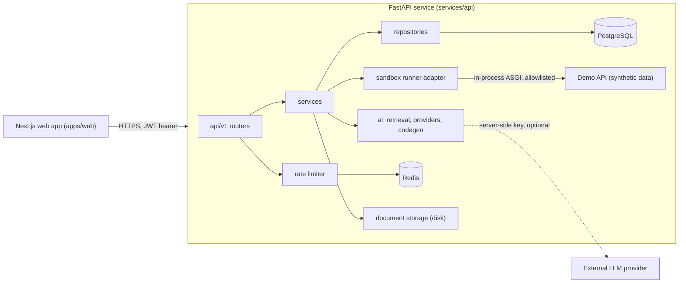
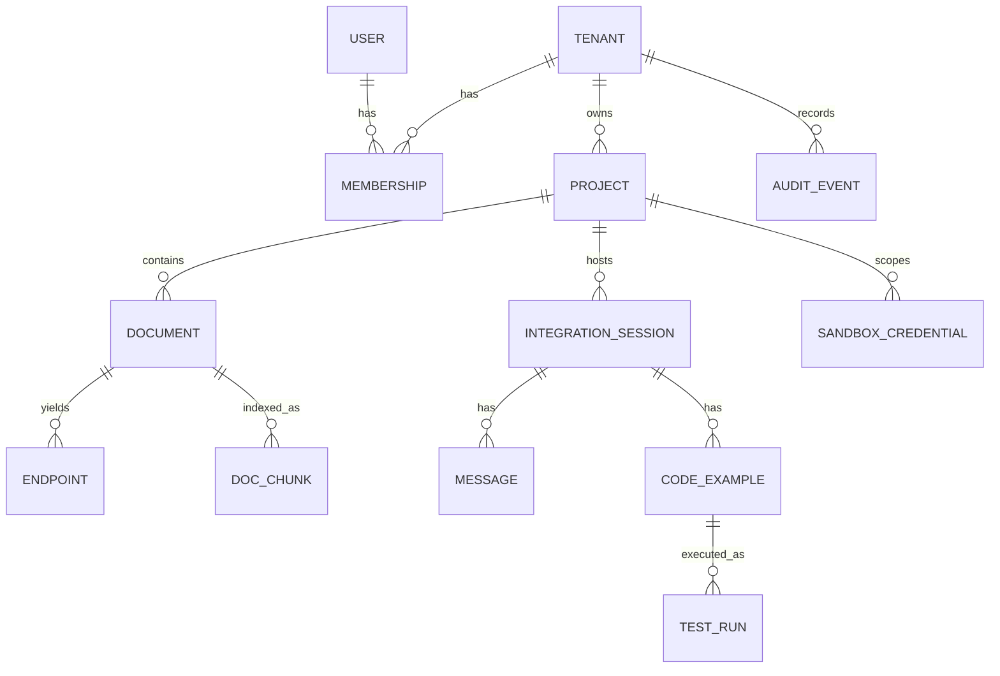

# CoreSync AI — Architecture

CoreSync AI is a **modular monolith**: one FastAPI service, one Next.js web app, PostgreSQL, and Redis. There are no independently deployed microservices because there is no technical need for them yet.

## Repository layout

| Path | Purpose |
|------|---------|
| `apps/web` | Next.js (App Router), TypeScript strict, Tailwind, shadcn/ui, Monaco, TanStack Query. |
| `services/api/app` | FastAPI app: `api/` routers, `core/` config and errors, `db/` session and base, `models/`, `schemas/`, `repositories/`, `services/`, `ai/`, `security/`, `sandbox/` (demo API and runner). |
| `services/api/migrations` | Alembic migrations. |
| `docs/` | PRD, architecture, security, API, development guide, implementation plan. |
| `samples/` | Sample OpenAPI/Markdown documents for the demo API. |
| `scripts/` | Developer scripts (for example, a demo seed). |

`packages/shared` is not created. The frontend consumes the backend through typed API client code, and an empty shared package would have no purpose. It can be added when shared contracts, such as generated OpenAPI types, are needed.

## Backend layering

`router → service → repository → model`. Routers validate input (Pydantic) and resolve the authenticated principal. Services hold business rules and authorization checks. Repositories hold **all** database access. Every repository query for tenant-owned data requires a `tenant_id`, so a missing tenant check is a type error and not a silent leak.

## Data model

Every tenant-owned table carries `tenant_id`, which is denormalized on purpose to make isolation checks and tests simple.

| Entity | Notes |
|--------|-------|
| `users` | Unique email, Argon2id password hash. |
| `tenants`, `memberships` | A user can belong to many tenants. Role is one of `owner`, `member`, `developer`. |
| `projects` | Belong to a tenant. Have a creator and an archive flag. |
| `documents` | Versioned per project and filename. Fields: `doc_type`, `sha256`, `storage_key` (random, never user-controlled), `status` (`pending`, `processing`, `processed`, `failed`), `validation_errors`. |
| `endpoints` | Method, path, operation id, summary, parameters, request body, responses, security. |
| `doc_chunks` | Retrieval units: one per endpoint, per schema, and per Markdown section. Each carries a human-readable `ref`. |
| `integration_sessions`, `messages` | A developer's workspace session. Messages record the provider mode (`offline` or `llm`) and references. |
| `code_examples` | Generated code, its sha256, and the **request plan** that the runner executes. |
| `sandbox_credentials` | Only the SHA-256 hash and a short prefix are stored. Also tenant, project, environment, `expires_at`, `revoked_at`, and the quota counter. |
| `test_runs` | Real outcome of an executed plan: status, HTTP status, sanitized body, duration. |
| `audit_events` | Action, actor, resource, request id, and metadata. Metadata is scrubbed of secrets. |

## AI layer

- `LLMProvider` protocol with `generate(messages) -> LLMResult`.
  - `OfflineProvider` is deterministic and extractive. It composes answers from retrieved chunks, and every response is labelled `mode=offline`.
  - `OpenAICompatibleProvider` calls a configured chat-completions endpoint (`LLM_BASE_URL`, `LLM_MODEL`, `LLM_API_KEY`, all server-side). It is selected only when configured.
- **Retrieval:** lexical BM25-style scoring over `doc_chunks`, always filtered by `tenant_id` and `project_id` in the SQL query. An `Embedder` interface is documented as the extension point for pgvector.
- **Grounding:** a score threshold decides whether evidence is sufficient. If it is not, the answer says that the documentation does not contain enough information and no code is generated.
- **Code generation is deterministic.** A `RequestPlan` (method, path, query, body) is derived from the indexed endpoint, never from LLM text. Python code is rendered from a template using the plan. The LLM may add explanation text only. This keeps tool arguments validated independently of model output.

## Sandbox and test execution

See [SECURITY.md](SECURITY.md) for the threat model. The architecture is:

1. A developer issues a **sandbox credential** (`csk_<id>_<secret>`) scoped to tenant, project, and environment `demo`, with a TTL and a request quota.
2. A `CodeExample` stores its `RequestPlan`.
3. `POST /v1/sessions/{id}/runs` validates the user, the session, the example, **and the credential** (DB lookup of the hash, expiry, revocation, scope, quota, rate limit). It then calls a `SandboxRunner`.
4. `DemoApiRunner` is the only MVP runner. It sends the validated plan to the **demo API** through an in-process ASGI transport, so it has no network egress by construction. The allowed path prefix is checked, the output size is capped, and there is a timeout.
5. The demo API **independently** validates the credential on every request. It has synthetic data only.
6. The result is stored as a `TestRun` and returned.

Free-form Python code is **not executed**. The runner is an adapter interface (`SandboxRunner`) so a container-based runner can be added later, once isolation can be verified. See ADR-006.

## Authentication

Email and password. Passwords are hashed with Argon2id. Access tokens are short-lived JWTs (HS256, server-side secret) sent in the `Authorization: Bearer` header. Because no cookies carry authentication, CSRF does not apply. The cost is that the browser must store the token. See ADR-004.

## Architecture decision records

| ADR | Decision | Rationale |
|-----|----------|-----------|
| 001 | Modular monolith | Simplest deployable unit. Layering keeps modules separable later. |
| 002 | Sync SQLAlchemy 2.x with `psycopg` 3 | FastAPI runs sync endpoints in a threadpool. This is simpler and sufficient for the MVP. Migrating to async is possible later. |
| 003 | Tests run on SQLite, with PostgreSQL verified separately when available | Docker and PostgreSQL are not installed on the development machine. Models use portable types (`Uuid`, `JSON`). Migrations are additionally checked on real PostgreSQL where possible. See DEVELOPMENT.md for status. |
| 004 | JWT bearer tokens held in `sessionStorage` | Avoids cookie and CSRF surface for the MVP. XSS exposure is mitigated by React escaping, no `dangerouslySetInnerHTML`, and a strict CSP. A refresh-token, httpOnly-cookie flow is future work. |
| 005 | Own OpenAPI structural validator, with no remote `$ref` resolution | Generic validators can fetch remote references, which creates an SSRF risk. We resolve only local `#/` references. External refs are rejected. |
| 006 | No arbitrary code execution in MVP | An isolated runner cannot be implemented and verified without container tooling. The demo-only request-plan runner is labelled as such in the UI and API. |
| 007 | Lexical retrieval first, with pgvector deferred | Works with no embedding credentials and is deterministic. The `Retriever` interface allows hybrid search later. |
| 008 | Rate limiting through a `RateLimiter` interface: Redis in deployment, in-memory when `REDIS_URL` is unset | Redis is optional for local development. Health reports the actual state. Authorization never relies on Redis. |
| 009 | Sandbox tokens are stored as SHA-256 hashes | Tokens carry 256 bits of entropy, so a fast hash is appropriate. The DB row is authoritative for expiry and revocation. |
